# 01 · Template Financeiro para o ERP Omie

> Modelo semântico e relatório de Power BI para gestão financeira (FP&A) de empresas que usam o ERP **Omie**. É um *template* replicável: o mesmo arquivo atende vários clientes, trocando só os parâmetros de conexão.

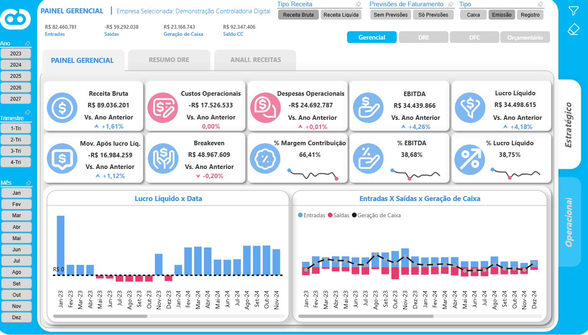

Prints com dados da base de testes (empresa de demonstração).

## Problema de negócio

Empresas de pequeno e médio porte que usam o Omie precisavam de uma visão gerencial que o ERP não entrega pronta: uma DRE por competência e por caixa, análise vertical e horizontal, fluxo de caixa projetado, controle orçamentário (previsto x realizado), prazos médios de recebimento e pagamento, inadimplência e análise de faturamento por cliente e produto.

## Solução

- **Um modelo semântico único**, publicado no Power BI Service, com **731 medidas DAX** organizadas por tema (DRE, Faturamento, Fluxo de Caixa, Contas a Pagar, Compras, Contratos, Curva ABC, Orçamento).
- **Template multiempresa:** os parâmetros `Server`, `DB`, `Schema` e `cd40_id` (código da empresa) definem de quem são os dados. Um novo cliente entra sem mudar o modelo.
- **Consultas nativas com *query folding*** no PostgreSQL (camada tratada do *data warehouse*): o filtro por empresa roda no banco, não no Power BI.
- **Relatório fino separado** (*thin report*) em conexão dinâmica com o modelo. Assim, o layout evolui sem republicar os dados.

## Arquitetura

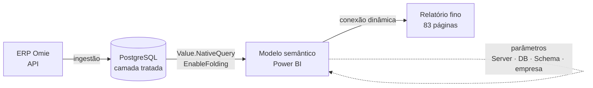

## Números do modelo

| Item | Quantidade |
|---|---|
| Tabelas | 99 (fatos, dimensões, parâmetros e tabelas auxiliares) |
| Colunas | 666 |
| Medidas DAX | **731** |
| Relacionamentos | 130 (vários inativos, ativados por `USERELATIONSHIP`) |
| Consultas Power Query | 76 (61 consultas nativas no PostgreSQL) |
| Páginas do relatório | 83 (painéis, páginas de detalhe e *tooltips*) |

## Modelo de dados (núcleo)

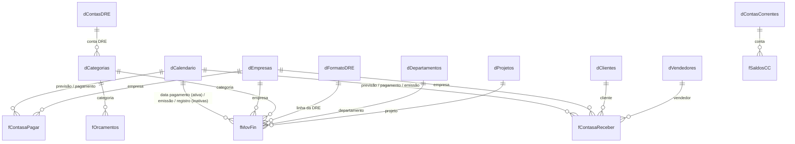

Outras fatos do modelo: `fNotaFiscal`, `fNFServico`, `fPedidosdeVendas`, `fPedidosCompras`, `fNFsEntrada`, `fSaldoEstoque`, `fContratosAtivos`, `fContratosCancelados`, `fBudget`, `fBudgetDFC`, `fMetas`, `fOrdensServ`, `fCRVencidos`, `fCPVencidos`.

## Páginas do relatório

| Área | Páginas |
|---|---|
| Visão executiva | Painel Gerencial, Resumo Financeiro, Resumo DRE, Ciclo Financeiro, Metas |
| DRE | DRE, DRE AV/AH, DRE Comparativo, Fatores de Receita, Fatores de Custo/Despesa, Evolução dos Indicadores, Categorias sem conta DRE, DRE Analítico |
| Caixa | DFC, Fluxo de Caixa (diário e mensal), Previsto x Realizado, Projeção |
| Orçamento | Controle Orçamentário (DRE e DFC), Influenciadores (*Key Influencers*) |
| Recebíveis e pagáveis | Contas a Receber, Eficiência de Recebimento, Prazo Médio de Recebimento, Contas a Pagar, Prazo Médio de Pagamento, Análise de Custos e Despesas |
| Comercial | Analítico de Faturamento, Pedidos de Venda |
| Navegação | ~40 páginas de *drill-through* e *tooltips* (detalhes de cada indicador) |

## Destaques técnicos

- **DRE gerencial em medidas:** Receita Bruta → Receita Líquida → Margem de Contribuição → EBITDA → Lucro Líquido, com versões por **competência** e por **caixa**. Ver [`dax/dre-indicadores.dax`](dax/dre-indicadores.dax).
- **Análise vertical e horizontal:** AV% sobre a Receita Bruta (com `ALL` seletivo para ignorar o filtro de categoria e cliente) e AH% contra o mês anterior.
- **Ponto de equilíbrio** e comparação com o ano anterior (`SAMEPERIODLASTYEAR`).
- **Capital de giro:** PMR e PMP ponderados pelo valor do título (`SUMX` de prazo × valor), inadimplência e saldo projetado acumulado. Ver [`dax/fluxo-caixa-recebiveis.dax`](dax/fluxo-caixa-recebiveis.dax).
- **Consulta parametrizada multiempresa** em M. Ver [`power-query/consulta-parametrizada.m`](power-query/consulta-parametrizada.m).
- **Visuais personalizados** usados com critério: Chiclet Slicer, KPI Donut, Waffle, KPI Status with History.

## Galeria

Prints do relatório com dados da **base de testes** (empresa de demonstração do ERP).

### Visão estratégica

| | |
|---|---|
| 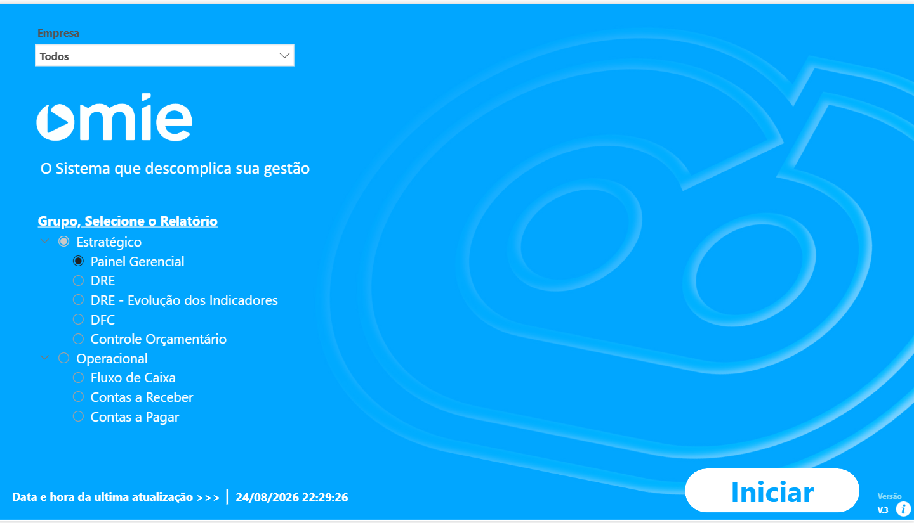 **Home e navegação** |  **Painel gerencial** |
| 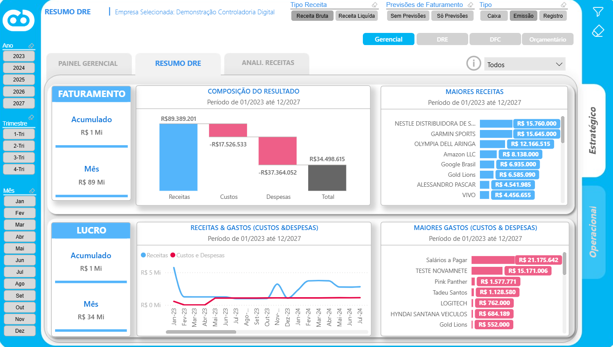 **Resumo da DRE** | 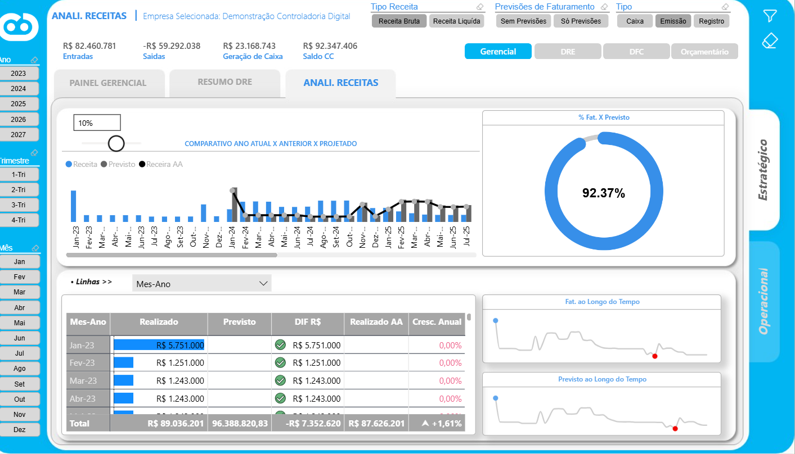 **Receita x previsto x ano anterior** |
| 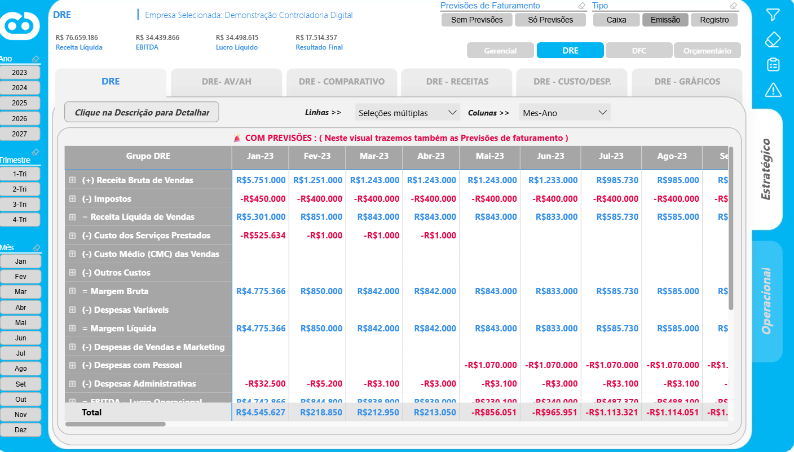 **DRE gerencial** | 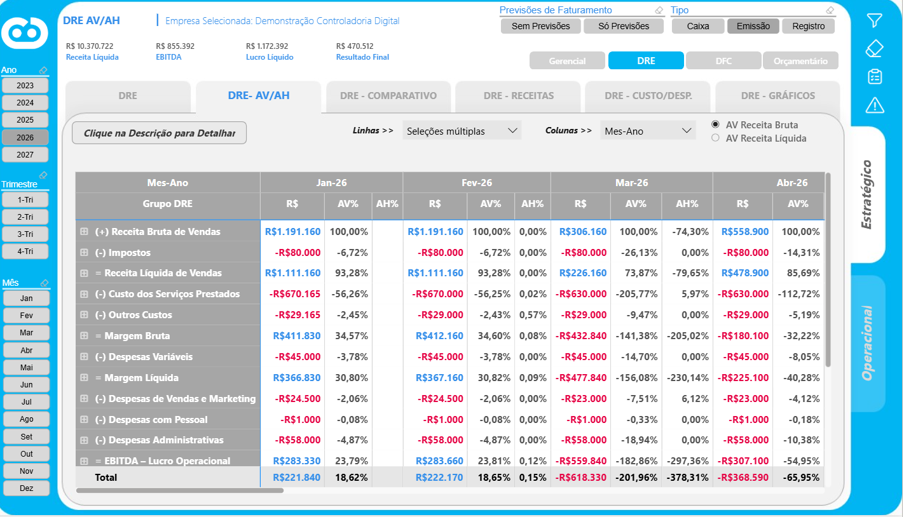 **DRE com análise vertical e horizontal** |
| 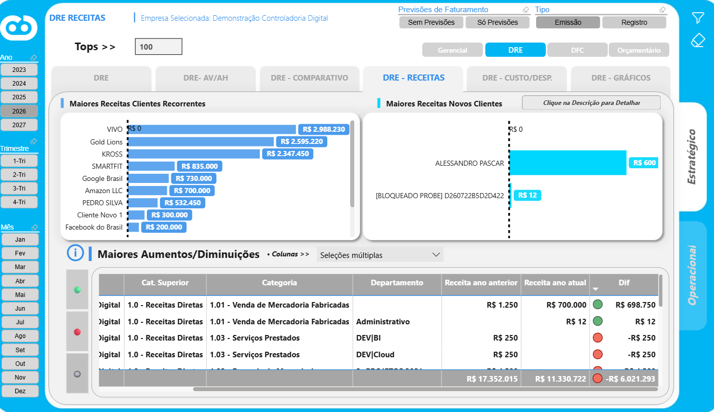 **Receitas: clientes novos x recorrentes** | 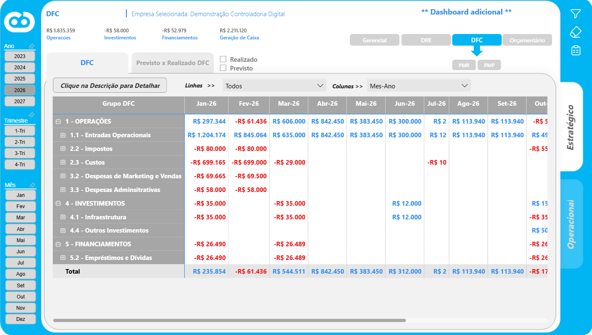 **DFC** |

### Visão operacional

| | |
|---|---|
| 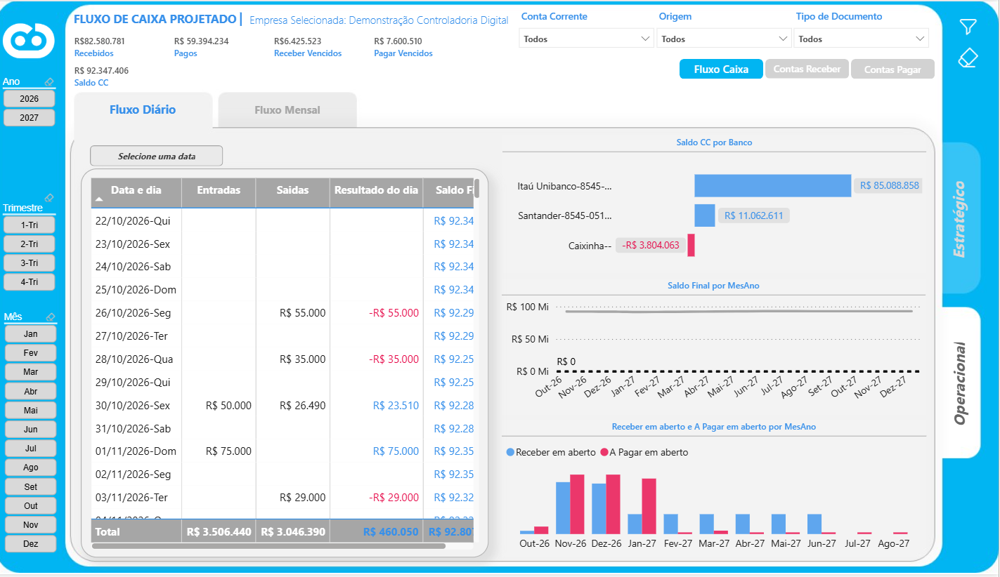 **Fluxo de caixa projetado (diário)** | 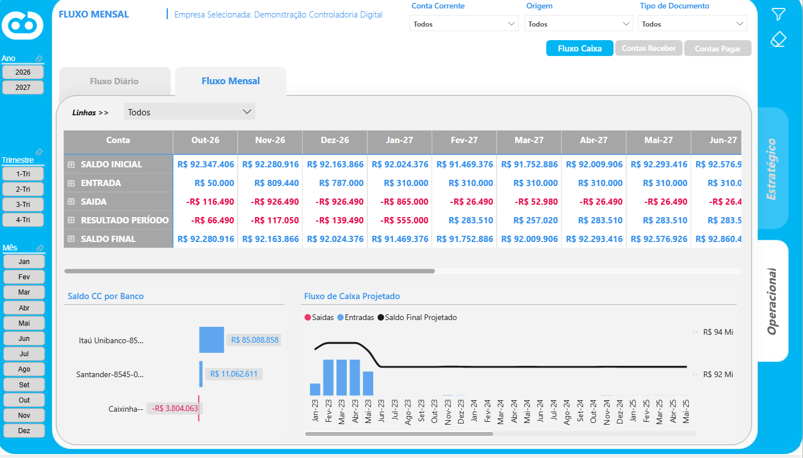 **Fluxo de caixa mensal** |
| 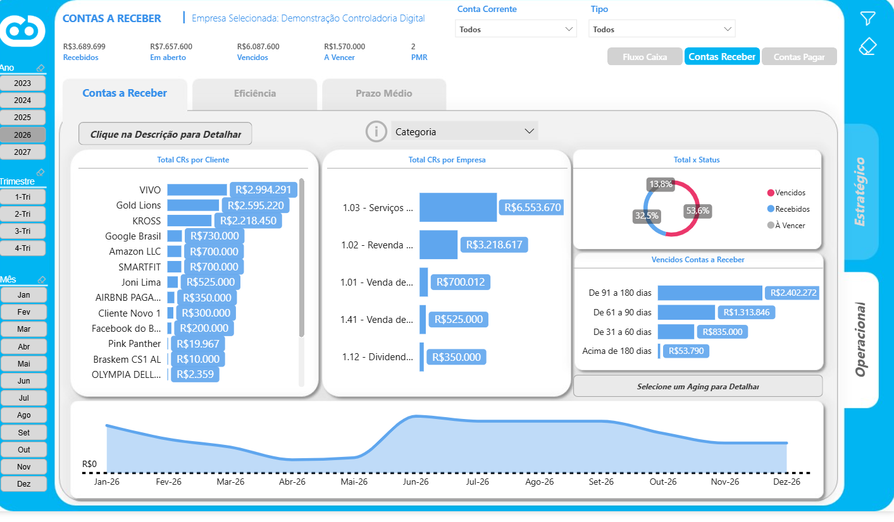 **Contas a receber e aging** | 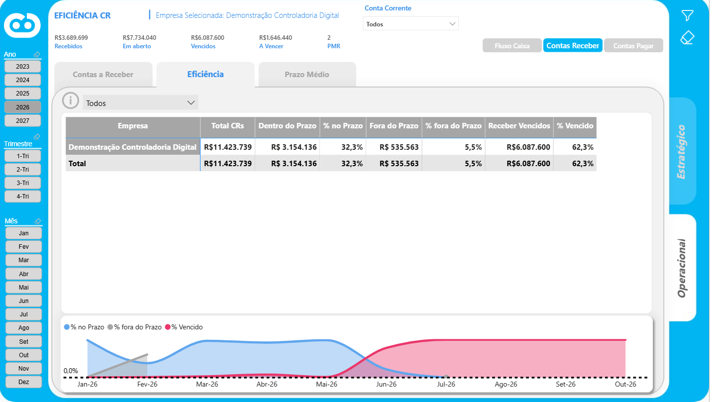 **Eficiência do recebimento** |
| 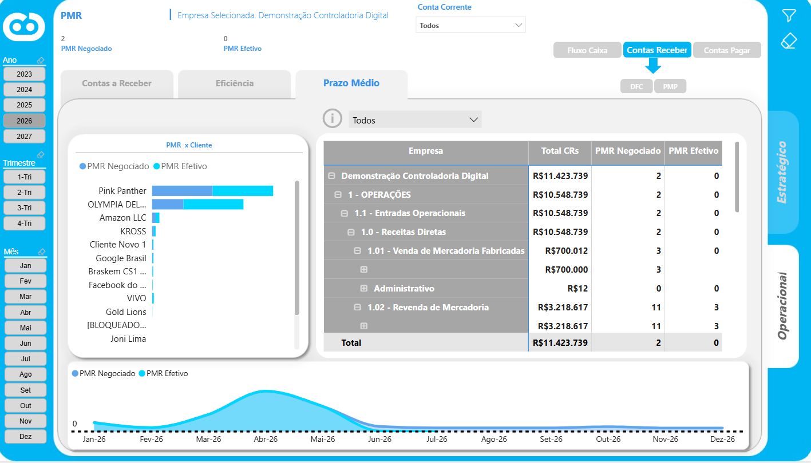 **Prazo médio de recebimento** | 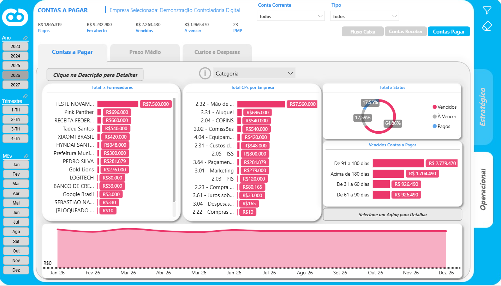 **Contas a pagar** |
| 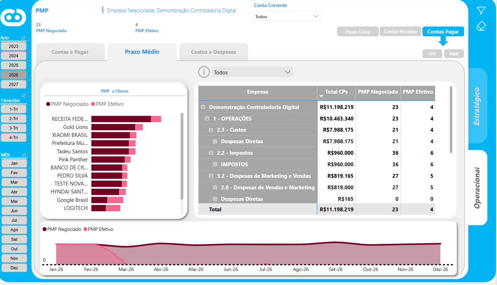 **Prazo médio de pagamento** | 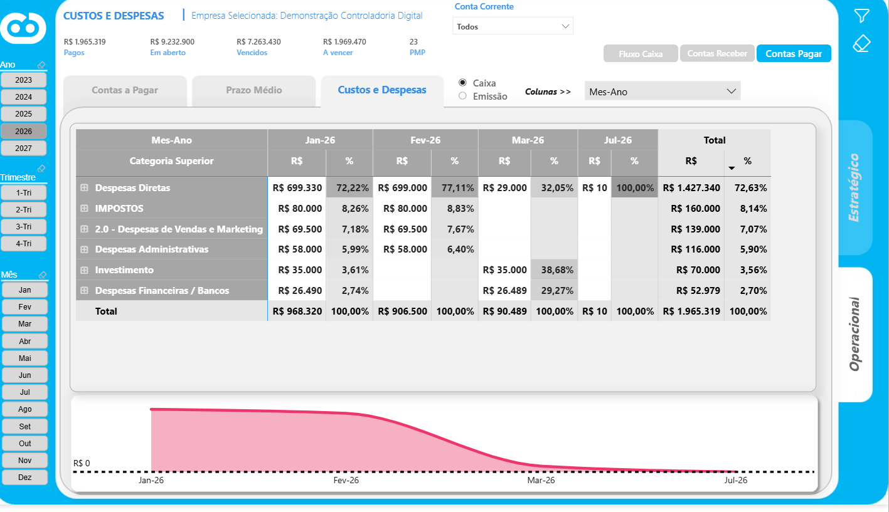 **Custos e despesas por categoria** |
