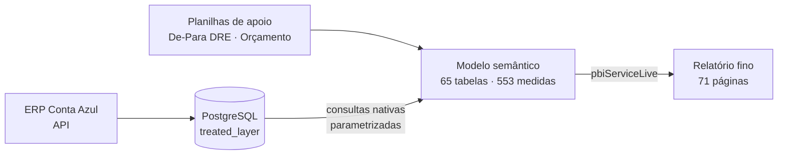
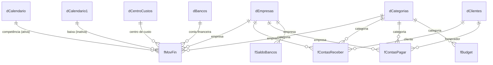

# 02 · Template Financeiro para o ERP Conta Azul

> Versão do template financeiro para o ERP **Conta Azul**, com um **modelo semântico compartilhado** e um **relatório fino** separado no Power BI Service.

<!-- Tire o comentário depois de colocar o print na pasta imagens/:  -->

## Problema de negócio

Clientes do Conta Azul precisavam de DRE, DFC, controle orçamentário e gestão de recebíveis com o mesmo padrão de análise do template Omie. A estrutura de dados do Conta Azul, porém, é outra: títulos, baixas, centros de custo, contas financeiras e saldos bancários seguem regras próprias.

## Solução

- Modelo reescrito sobre a camada tratada (`treated_layer`) do PostgreSQL, com o **mesmo padrão de medidas** do template Omie. Quem usa um template reconhece o outro.
- **Separação modelo × relatório:** o arquivo do modelo (com 48 páginas próprias) é publicado uma vez; o relatório de uso (71 páginas) é um *thin report* em conexão dinâmica (`pbiServiceLive`).
- Visões por **competência** e por **caixa (baixa)**, com três tabelas calendário e relacionamentos inativos ativados sob demanda.
- **Planejamento orçamentário** (`fBudget`, `fBudgetDFC`) com faixas de tolerância (±50%, ±75%) para formatação condicional.
- **Aging de recebíveis** dinâmico, a partir de uma tabela de faixas (`dAgingCR`).

## Arquitetura

## Números do modelo

| Item | Quantidade |
|---|---|
| Tabelas | 65 |
| Colunas | 405 |
| Medidas DAX | **553** (DRE: 299 · Faturamento: 121 · Fluxo de Caixa: 45 · Orçamento: 28 · Contas a Pagar: 27) |
| Relacionamentos | 44 |
| Consultas Power Query | 47 |

## Modelo de dados (núcleo)

## Destaques técnicos

- **Aging com tabela de faixas:** o vencido é distribuído por faixa de dias (`DATEDIFF` contra as colunas `Min` e `Max` de `dAgingCR`), sem coluna calculada fixa. Ver [`dax/recebiveis-orcamento.dax`](dax/recebiveis-orcamento.dax).
- **Previsto x Realizado:** % de atingimento de receita e despesa, com a lógica invertida para despesa (estourar o orçado é ruim).
- **Saldo acumulado** por conta e por período.
- **Consultas organizadas em etapas comentadas** (`// 1. Conexão e Consulta SQL`), parametrizadas por servidor, banco, schema e empresa. Ver [`power-query/consulta-parametrizada.m`](power-query/consulta-parametrizada.m).

## Imagens

Prints em [`imagens/`](imagens/). Veja [`imagens/LEIA-ME.md`](imagens/LEIA-ME.md).
