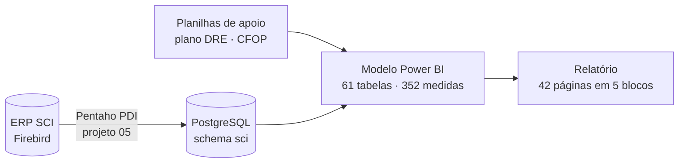
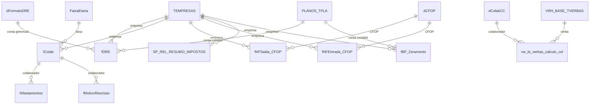

# 03 · BI Contábil, Fiscal e de RH para escritórios de contabilidade (ERP SCI)

> Relatório para escritórios de contabilidade que usam o ERP **SCI**. Ele reúne em um só lugar as visões **gerencial, contábil, fiscal, de folha de pagamento e do Simples Nacional** das empresas clientes do escritório.

<!-- Tire o comentário depois de colocar o print na pasta imagens/:  -->

## Problema de negócio

O escritório tinha os dados de várias empresas clientes no SCI, mas cada análise (balancete, DRE, índices de liquidez, rotatividade de pessoal, carga tributária) exigia relatórios separados e trabalho manual em planilhas. O objetivo era dar ao contador e ao cliente final uma visão consolidada e comparável entre períodos.

## Solução

- Dados extraídos do SCI (Firebird) para o PostgreSQL pelo **ETL Pentaho** do [projeto 05](../05-etl-pentaho-sci-postgresql/).
- Modelo com **352 medidas**, organizado em cinco blocos de navegação:

| Bloco | Páginas |
|---|---|
| 1 · Gerencial | Painel de Gestão, DRE Analítico, Analítico de Faturamento |
| 2 · Contábil | DRE AV/AH, DRE Comparativo, Projeção DRE, DRE Evolução de Indicadores, Contas sem Classificação, Balanço Patrimonial, BP Evolução, Balancete, Balancete Analítico |
| 3 · Fiscal | Entradas & Saídas por CFOP |
| 4 · RH | Resumo de Rotatividade, Contratações, Demissões, Folha de Pagamento, Desoneração da Folha |
| 5 · Simples Nacional | Simples Nacional x Faturamento do ano anterior |

- **Índices financeiros calculados a partir do plano de contas** (`PLANOS_TPLA`): liquidez corrente, seca e geral, endividamento geral e composição do endividamento, com comparação ao ano anterior e farol de cor.
- **Indicadores de pessoas:** headcount inicial e final, contratações, demissões, turnover, faixa etária e tempo de casa.
- **Função M de anonimização** para demonstrar o relatório sem expor nomes de colaboradores ou clientes.

## Arquitetura

## Números do modelo

| Item | Quantidade |
|---|---|
| Tabelas | 61 |
| Colunas | 408 |
| Medidas DAX | **352** |
| Relacionamentos | 31 |
| Consultas Power Query | 49 |
| Páginas | 42 |

## Modelo de dados (núcleo)

## Destaques técnicos

- **Índices de liquidez e endividamento** a partir dos níveis do plano de contas (Ativo Circulante = nível 11, Passivo Circulante = nível 21 etc.). Ver [`dax/indices-financeiros.dax`](dax/indices-financeiros.dax).
- **Headcount acumulado** a partir de contratações e demissões, sem tabela de foto mensal. Ver [`dax/indicadores-rh.dax`](dax/indicadores-rh.dax).
- **Carga tributária** = impostos / receita bruta.
- **Função de anonimização em M**: mantém os primeiros e os últimos caracteres e mascara o meio (ex.: `Maria Silva` → `Mar*****lva`). Ver [`power-query/fn-anonimizador.m`](power-query/fn-anonimizador.m).

## Imagens

Prints em [`imagens/`](imagens/). Veja [`imagens/LEIA-ME.md`](imagens/LEIA-ME.md).
