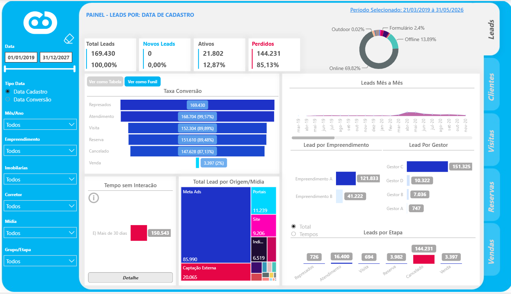
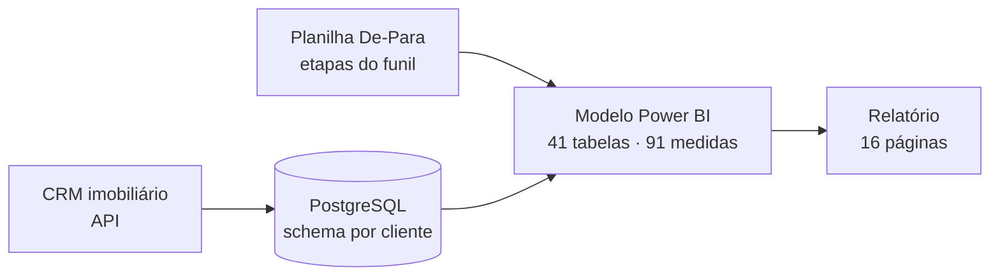
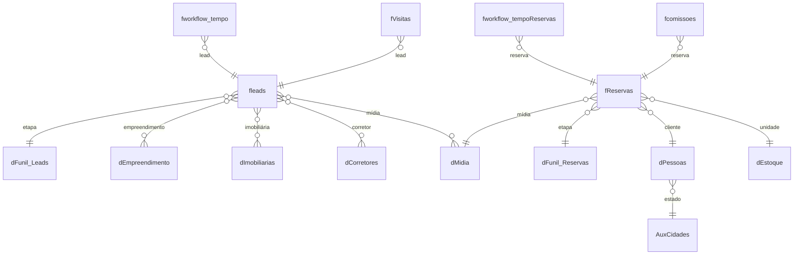
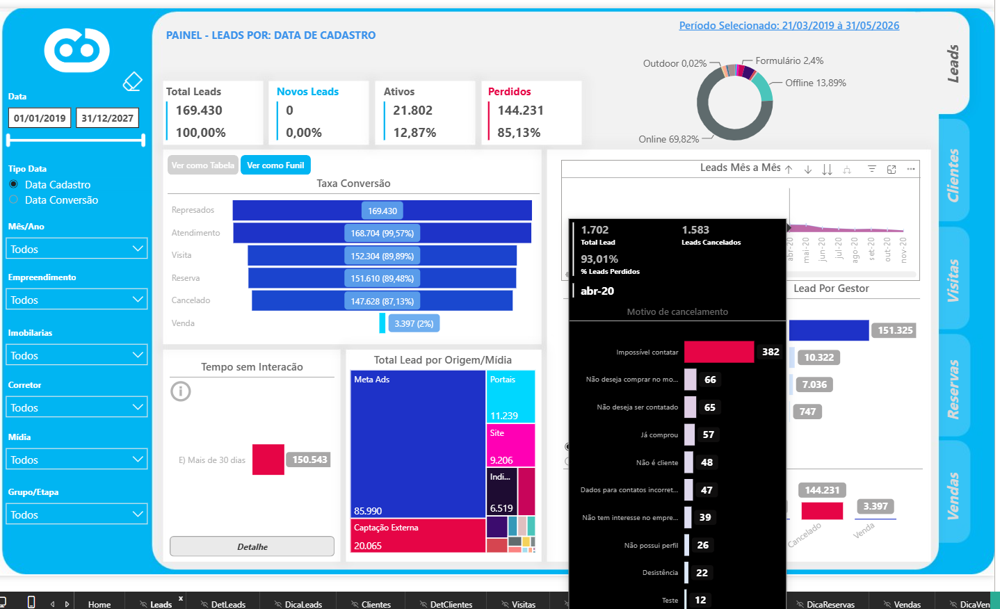
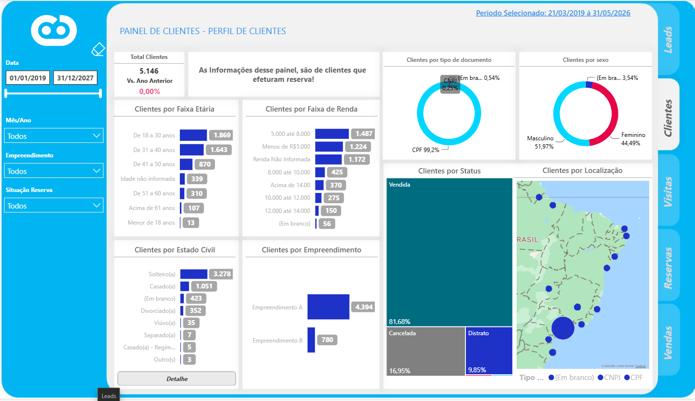
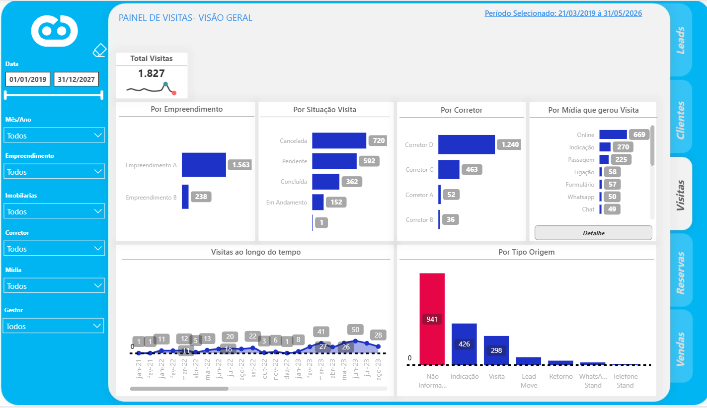
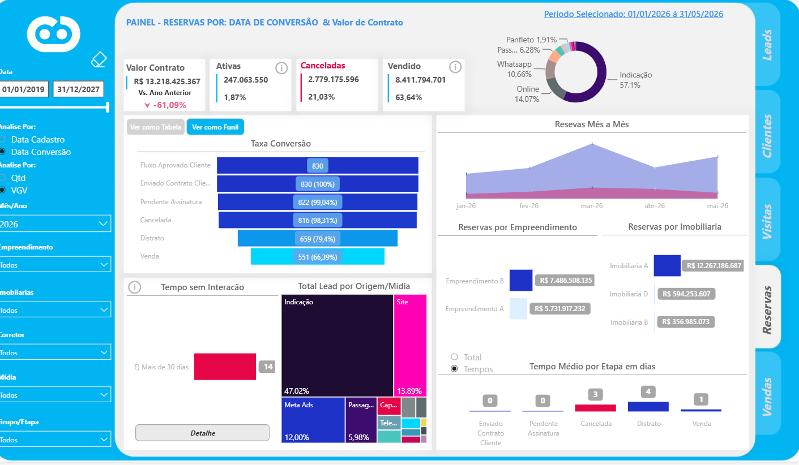
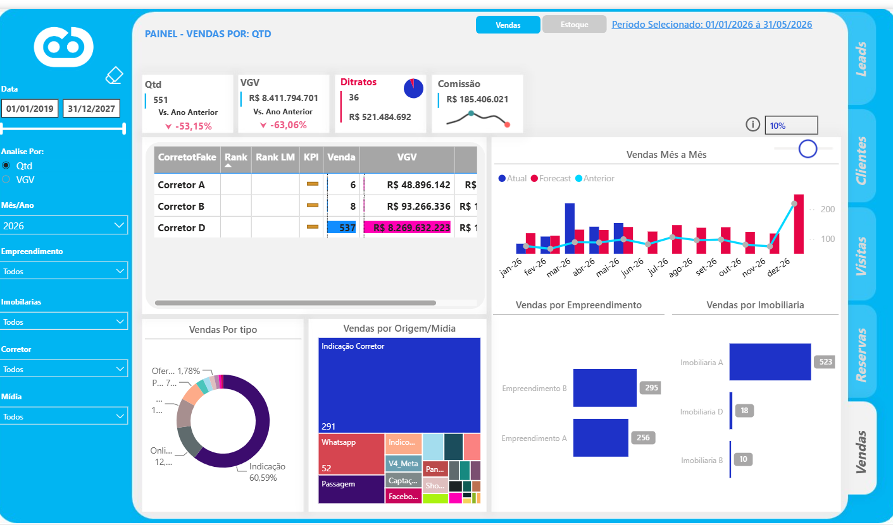
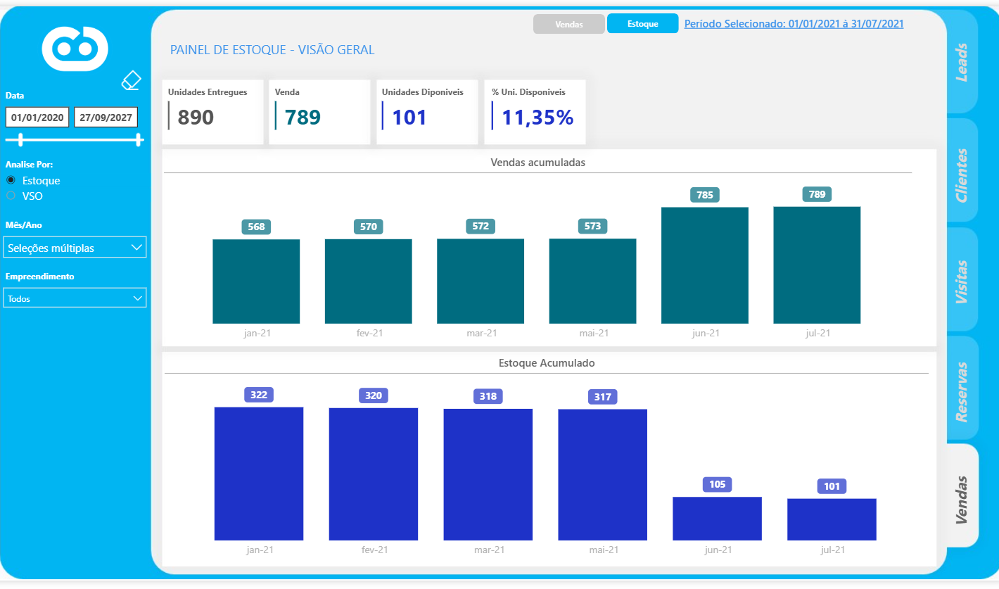
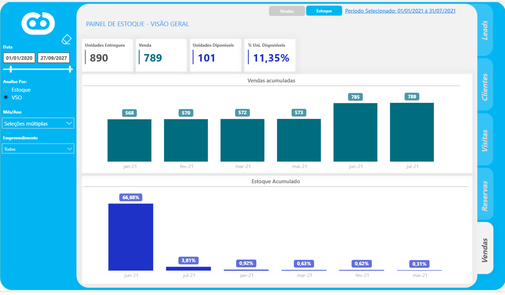

# 04 · CRM Imobiliário: funil de Leads, Reservas e Vendas

> Relatório comercial para incorporadoras e construtoras, alimentado pela API de um CRM imobiliário. Acompanha o funil completo, do lead à venda, além do estoque de unidades e do desempenho de corretores e imobiliárias.

Prints com empreendimentos, corretores, gestores e imobiliárias anonimizados.

## Problema de negócio

A diretoria comercial não conseguia responder com rapidez perguntas como: *quantos leads viram reserva e quantas reservas viram venda? Qual mídia traz os leads que mais convertem? Quanto tempo um lead fica em cada etapa? Qual corretor vende mais, e com que ticket? Como estamos contra o ano passado?*

## Solução

Relatório com navegação por botões e páginas de detalhe, em seis áreas:

| Área | O que mostra |
|---|---|
| **Leads** | Total, ativos, perdidos, cancelados, novos; funil por etapa; conversão acumulada; tempo médio por etapa; origem por mídia |
| **Clientes** | Base de clientes, crescimento contra o ano anterior, mapa por cidade e estado |
| **Visitas** | Visitas por período, empreendimento e corretor |
| **Reservas** | Funil de reservas, valor reservado, cancelamentos, tempo por etapa, valor por quantidade |
| **Vendas** | Vendas e **VGV** (Valor Geral de Vendas), distratos, comissões, ticket médio, ranking de corretores, crescimento contra o ano anterior, **forecast** parametrizável |
| **Estoque** | Unidades por situação e por empreendimento |

## Arquitetura

## Modelo de dados (núcleo)

## Destaques técnicos

- **Taxa de conversão acumulada do funil:** para cada etapa, soma os registros que chegaram *naquela etapa ou além*. Usa `CALCULATETABLE` + `ALL` + `KEEPFILTERS` para ignorar o filtro da etapa atual sem perder os demais (empresa, corretor, período). Ver [`dax/funil-vendas.dax`](dax/funil-vendas.dax).
- **VGV pela data da venda**, com `USERELATIONSHIP` ativando o relacionamento inativo entre calendário e `data_venda`.
- **Ranking dinâmico de corretores** (`RANKX` + `ALLSELECTED` + `ISINSCOPE`), que respeita os filtros da página.
- **Forecast com parâmetro *what-if*:** projeção = vendas do ano anterior × (1 + % escolhido pelo usuário).
- **Cores dinâmicas** de crescimento (azul se positivo, rosa se negativo) aplicadas por formatação condicional baseada em medida.

## Galeria

Empreendimentos, corretores, gestores e imobiliárias anonimizados (A, B, C, D).

| | |
|---|---|
|  **Home e navegação** |  **Leads: funil, origem/mídia e etapas** |
|  **Tooltip com motivos de cancelamento** |  **Perfil de clientes e mapa** |
|  **Visitas por corretor, situação e mídia** |  **Reservas por VGV e tempo médio por etapa** |
|  **Vendas, ranking de corretores e forecast** |  **Estoque de unidades** |
|  **VSO (velocidade de vendas sobre oferta)** | |
