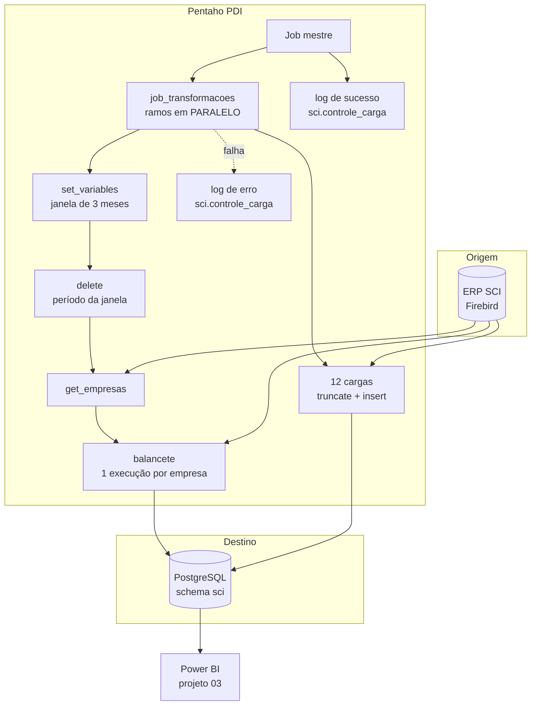

# 05 · ETL Pentaho: ERP SCI (Firebird) → PostgreSQL

> Pipeline de dados em **Pentaho Data Integration (PDI) 9.4** que copia dados contábeis, fiscais e de folha de pagamento do ERP **SCI** (banco Firebird) para um **PostgreSQL**, que alimenta o BI do [projeto 03](../03-bi-contabil-fiscal-rh-sci/). Inclui a **documentação técnica completa** e um **manual passo a passo** para reconstruir o processo do zero.

## Problema de negócio

O ERP contábil guarda os dados num banco Firebird com *stored procedures* próprias (o balancete, por exemplo, só sai por uma procedure com 25 parâmetros). Conectar o Power BI direto nesse banco deixava os relatórios lentos e sobrecarregava o ERP em horário de expediente. Era preciso uma cópia analítica, atualizada todos os dias, com histórico desde 2019.

## Solução

Quatro rotinas de carga, cada uma com seu objetivo:

| Rotina | Disparo | O que faz |
|---|---|---|
| **Diária** | Agendador do Windows → `Kitchen` | Recarrega 13 tabelas de dimensão e fato (*truncate + insert*) e os **últimos 3 meses** do balancete de todas as empresas |
| **Anual** | Agendada | Recarrega os **últimos 25 meses** do balancete (pega lançamentos retroativos) |
| **Por empresa** | Manual, com parâmetro `EMPRESA` | Recarrega 25 meses de **uma** empresa (correção pontual) |
| **Inicial** | Manual | Apaga e recarrega o balancete **mês a mês desde 01/2019** |

## Arquitetura

## Tabelas carregadas

| Tabela de destino | Conteúdo | Tipo de carga |
|---|---|---|
| `vsuc_empresas_tlan` | Balancete mensal por empresa e conta | *Delete* da janela + *insert* (incremental) |
| `planos_tpla`, `centros_tpcc` | Plano de contas e centros de custo | *Truncate + insert* |
| `tempresas_aux`, `dmatriz`, `dfechamentosmensais` | Cadastro de empresas, matrizes e fechamentos | *Truncate + insert* |
| `vef_emp_tmovsai`, `tsimples`, `sp_rel_resumo_impostos` | Notas de saída, Simples Nacional, resumo de impostos | *Truncate + insert* |
| `dcolab`, `dcolab_cc`, `fafastamentos`, `vrh_base_tverbas`, `vw_bi_verbas_calculo_col` | Colaboradores, centros de custo, afastamentos, verbas e folha | *Truncate + insert* |
| `controle_carga`, `controle_carga_inicial` | Log de execução | *Insert* |

## Destaques técnicos

- **Carga incremental por janela de meses:** variáveis `MES_00 … MES_24` calculadas no próprio PDI (Calculator + Formula + regex), com escopo de *root job*. Ver [`python/janela_meses.py`](python/janela_meses.py), que reproduz o algoritmo.
- **Execução por linha** (*execute for every input row*): a lista de empresas vem de uma consulta e o balancete roda uma vez por empresa.
- **Orquestração em paralelo** de 13 ramos, com tratamento de erro por ramo gravado numa tabela de controle.
- **Contorno do driver Jaybird**, que devolve nomes genéricos (`SUM`, `CASE`, `MIN_1`) em vez do *alias* do SQL. Resolvido com passos *Select values*.
- **Recursive CTE** no PostgreSQL para gerar os meses da carga histórica. Ver [`sql/04-calendario-meses.sql`](sql/04-calendario-meses.sql).
- **Consultas de verificação** (duplicidade, volume por mês, último sucesso). Ver [`sql/05-verificacao.sql`](sql/05-verificacao.sql).

## Análise crítica e melhorias propostas

Ao documentar o processo herdado, levantei e registrei estes pontos:

1. **Conexões duplicadas em cada arquivo, apontando para hosts diferentes.** Proposta: uma conexão compartilhada (`shared.xml`) com variáveis no `kettle.properties`.
2. **Um job legado chamava a si mesmo** (recursão infinita). Foi marcado como "não replicar".
3. **Valores de competência fixos no SQL** (ex.: um mês de 2023). Proposta: usar a competência atual.
4. **Máscara `YYYY` (ano da semana, no Java)** em vez de `yyyy`. Pode gerar datas erradas na virada do ano.
5. **Limpeza de texto diferente entre rotinas**, o que deixava o mesmo nome de conta gravado de formas diferentes.
6. **Job paralelo podia terminar "OK" mesmo com um ramo falhando.** Proposta: monitorar a tabela de controle.
7. **Log sem rotação**, já com mais de 2 GB.
8. **Destino sem chave primária:** a proteção contra duplicidade dependia da ordem *delete → insert*. Proposta: PK em `(empresa, plano, conta, período)`.

## Documentação

- [`docs/especificacao-tecnica.md`](docs/especificacao-tecnica.md): resumo da especificação (jobs, transformações, regras de negócio, critérios de aceite).
- [`docs/pipeline.yaml`](docs/pipeline.yaml): manifesto declarativo do pipeline, para replicar fora do Pentaho.
- [`sql/`](sql/): DDL de controle, consultas de origem e de verificação.

> Senhas, IPs, hosts e nomes de clientes foram removidos. O SQL das *stored procedures* do ERP aparece só onde é necessário para entender a lógica.
