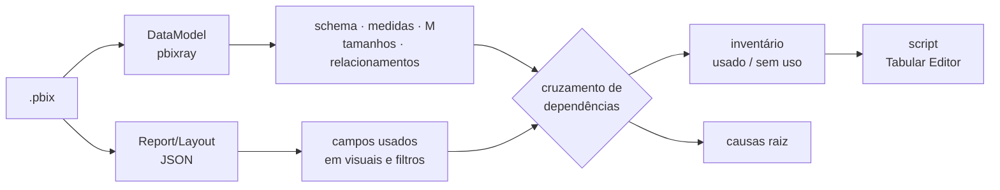

# 06 · Auditoria de performance de um modelo Power BI

> Diagnóstico de um relatório de CRM imobiliário (162 MB, 47 páginas) cuja atualização no Power BI Service levava horas e falhava. Analisei o modelo **sem abrir o Power BI**, lendo o arquivo `.pbix` com Python, e entreguei um plano de ação e um script pronto para o Tabular Editor.

## Problema

- Atualização (*refresh*) de várias horas, com falhas frequentes.
- Arquivo grande e lento para editar.
- Pedido do cliente: deixar o modelo mais rápido e remover tabelas e medidas sem uso.

## Método

1. **Leitura do modelo VertiPaq com [`pbixray`](https://github.com/Hugoberry/pbixray)**, sem precisar do motor do Analysis Services: schema (164 tabelas, 2.073 colunas), 270 medidas, 706 colunas calculadas, 121 tabelas calculadas, 81 relacionamentos e 43 consultas M.
2. **Estatísticas de tamanho e cardinalidade** por coluna, para achar o que mais pesa.
3. **Leitura do layout do relatório** (JSON das 47 páginas), para saber quais campos aparecem em visuais e filtros.
4. **Cruzamento das dependências** (layout + relacionamentos + DAX), para classificar cada objeto como usado ou não usado.

## Causas raiz encontradas

| # | Causa | Impacto |
|---|---|---|
| 1 | **Auto Date/Time ligado** e a tabela calendário do modelo **sem nenhum relacionamento**. O Power BI criou **109 tabelas de data ocultas**, recalculadas a cada atualização | 109 das 121 tabelas calculadas e 668 das 706 colunas calculadas. Maior causa isolada |
| 2 | **Consultas M duplicadas e *query folding* quebrado**: a mesma tabela do PostgreSQL era lida e cruzada (*merge*) em 3 consultas diferentes; um JSON era expandido duas vezes | Mais leitura no banco; os *merges* entre consultas impediam o *folding* |
| 3 | **Tabela legada mantida junto com a nova**: a maior tabela do modelo (709 mil linhas, 15 MB) era usada em um único campo | Tamanho e tempo de atualização |

## Objetos sem uso (confirmados pela análise de dependência)

- 5 tabelas órfãs (inclusive uma de 709 mil linhas).
- 137 de 270 medidas sem nenhuma referência, marcadas para revisão manual (títulos dinâmicos e *tooltips* podem gerar falso positivo).
- 14 colunas calculadas órfãs.

## Entregáveis

- **Relatório de auditoria** (Word): resumo executivo, diagnóstico e plano de ação com 10 itens priorizados por impacto, esforço e risco.
- **Inventário** (Excel): as 164 tabelas com veredito, as medidas candidatas à exclusão e o mapa de consultas duplicadas.
- **Script C# para o Tabular Editor**: remove as tabelas de data automáticas, as tabelas e colunas órfãs, e marca a calendário como tabela de datas. Ver o modelo em [`scripts/otimizacao-tabular-editor.csx`](scripts/otimizacao-tabular-editor.csx).
- **Notebook de extração** com `pbixray`: [`scripts/extrair_metadados_pbix.py`](scripts/extrair_metadados_pbix.py).

## Lições

- Auto Date/Time deve ficar **desligado** em modelos com calendário próprio. E a calendário precisa estar **relacionada** às fatos.
- *Merges* entre consultas já carregadas quebram o *folding*. Prefira fazer o *join* no SQL de origem.
- Antes de apagar medidas, verifique títulos dinâmicos, formatação condicional e *tooltips*.
