# 07 · Gestão Comercial, Metas e Pacotes: rede de unidades de serviços

> Relatório para uma rede de unidades que vende **serviços, produtos e pacotes pré-pagos** (o cliente compra o pacote e consome as sessões depois). Acompanha faturamento, metas diárias por colaborador, comissões, curva de Pareto por classe de serviço, pacotes vendidos x consumidos, um painel de KPIs estratégicos e um resumo financeiro.

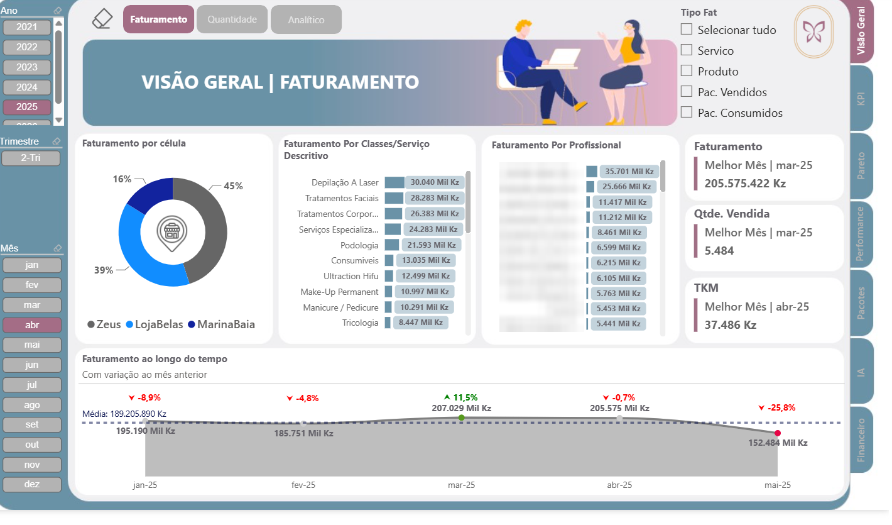

Prints de demonstração. Nomes de colaboradores foram desfocados.

## Problema de negócio

A gestão precisava acompanhar, por unidade e por colaborador, se as metas do mês estavam sendo cumpridas **no ritmo certo** (e não só no fechamento), quais classes de serviço concentram o faturamento, quanto foi pago em comissão e quanto do valor vendido em pacotes ainda não foi consumido pelos clientes (um compromisso futuro de entrega de serviço).

## Solução

| Área | O que mostra |
|---|---|
| **Resumo** | Faturamento e quantidade por tipo (serviço, produto, pacote), comparação com o mês anterior, melhor mês do ano |
| **Detalhamento de vendas** | Vendas por unidade, colaborador, classe e item |
| **Realizado x Meta** | Meta mensal por colaborador, **meta diária proporcional aos dias úteis**, percentual atingido até a data |
| **Pareto de classes** | Curva ABC com corte ajustável (60%, 70%, 80% ou 90%), ranking e variação de posição contra o mês anterior |
| **Performance** | Velocímetros e evolução diária acumulada contra a meta acumulada |
| **Comissões** | Comissão por colaborador sobre produtos e pacotes |
| **Pacotes** | Valor e quantidade de pacotes vendidos e consumidos, % de consumo, YTD e comparação com o ano anterior |
| **KPIs estratégicos** | Painel de 11 indicadores com meta e realizado: vendas de pacotes, ticket médio, satisfação do cliente, agendamentos, leads, turnover, horas de treinamento, despesas, lucratividade, desperdício de produtos |
| **Financeiro** | Entradas, saídas, saldo, DRE com AV/AH e lucro operacional por unidade |

## Arquitetura

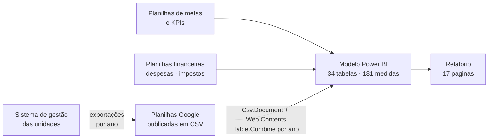

O cliente não tinha banco de dados: os dados saíam do sistema de gestão em planilhas anuais. Montei a ingestão em Power Query lendo cada planilha publicada e empilhando os anos com `Table.Combine`, para que um ano novo entre adicionando só uma consulta.

## Dados de demonstração

A pasta [`dados-demo/`](dados-demo/) traz planilhas **100% fictícias** no mesmo formato das originais (clientes, colaboradores, valores e metas inventados), geradas pelos scripts de [`scripts/`](scripts/). Com elas o relatório roda sem nenhum dado real: o passo a passo está em [`dados-demo/LEIA-ME.md`](dados-demo/LEIA-ME.md).

## Números do modelo

| Item | Quantidade |
|---|---|
| Tabelas | 34 |
| Colunas | 319 |
| Medidas DAX | **181** |
| Relacionamentos | 27 |
| Consultas Power Query | 92 (28 carregadas + 64 de apoio) |
| Páginas | 17 (mais páginas de *tooltip* e validação) |

## Modelo de dados (núcleo)

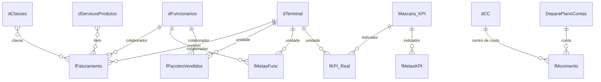

## Destaques técnicos

- **Meta diária proporcional aos dias úteis:** a meta do mês é distribuída pelos dias úteis (`NETWORKDAYS`) e acumulada até a data, para mostrar se o colaborador está no ritmo. Ver [`dax/metas-performance.dax`](dax/metas-performance.dax).
- **Pareto com corte dinâmico:** acumulado por classe com `ALLSELECTED`, e a cor da barra muda conforme o corte escolhido pelo usuário (60% a 90%). Ver [`dax/pareto-ranking.dax`](dax/pareto-ranking.dax).
- **Melhor mês com a função `INDEX`** (funções de janela do DAX) e **eixo Y dinâmico** para deixar espaço aos rótulos.
- **Pacotes vendidos x consumidos:** acumulados, % de consumo, YTD e LYTD só até o último dia com venda (evita comparar um ano parcial com um ano cheio).
- **Ingestão de planilhas anuais** com `Table.Combine`. Ver [`power-query/combinar-planilhas-anuais.m`](power-query/combinar-planilhas-anuais.m).

## Galeria

Nomes de colaboradores desfocados nos prints.

| | |
|---|---|
| 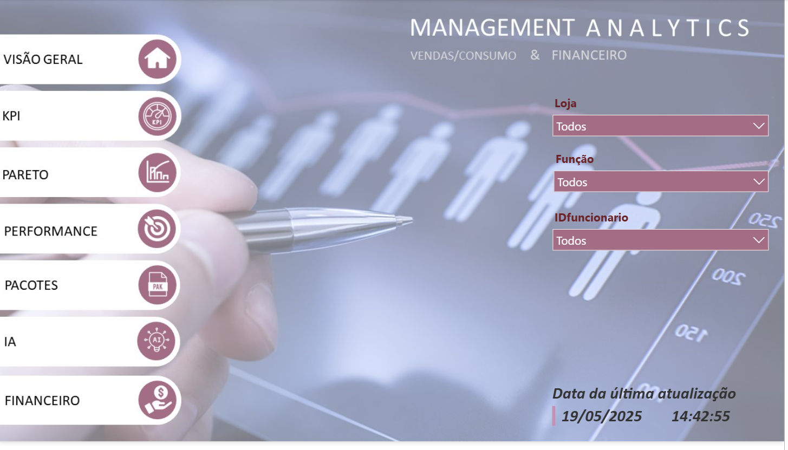 **Home e filtros** |  **Visão geral do faturamento** |
| 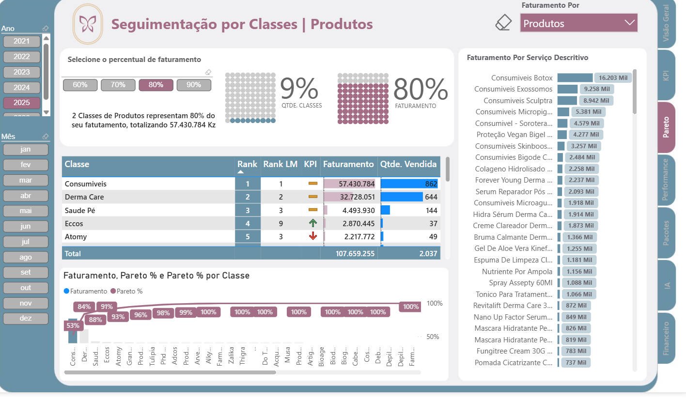 **Pareto por classe, com corte ajustável** | 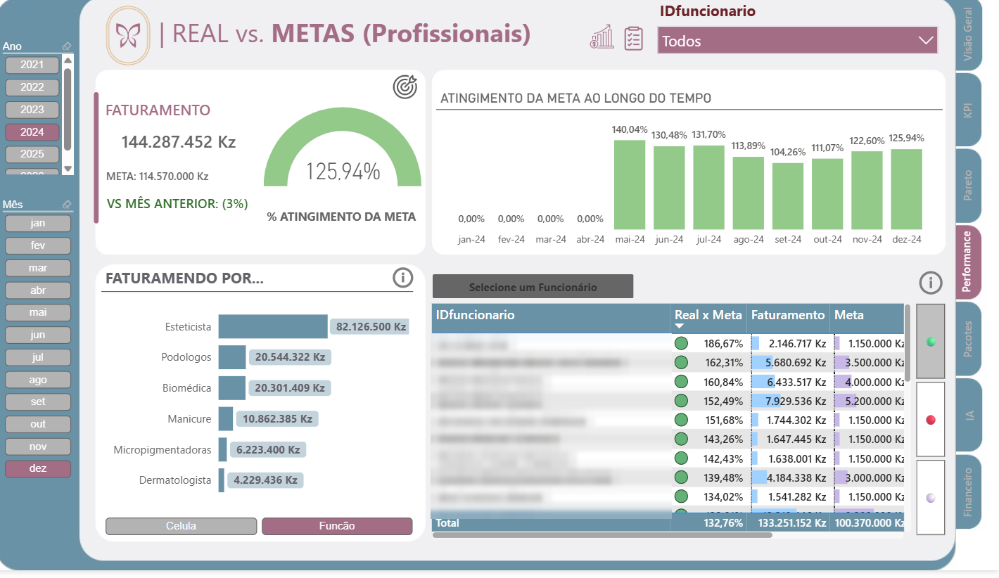 **Real x meta por profissional** |
| 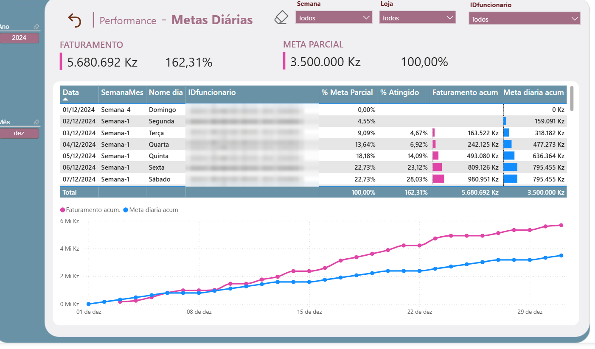 **Meta diária acumulada x faturamento** | 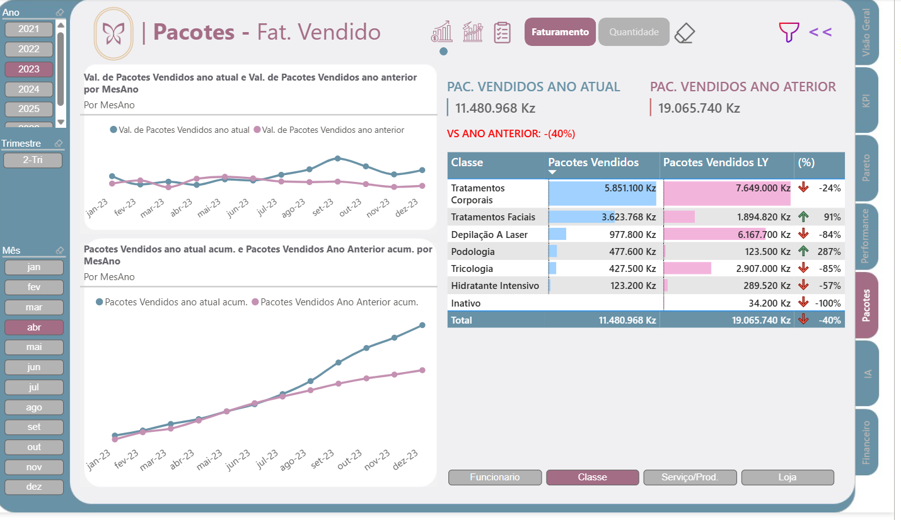 **Pacotes vendidos x ano anterior** |
| 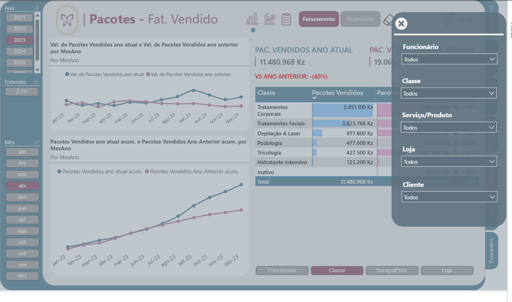 **Painel de filtros recolhível** | 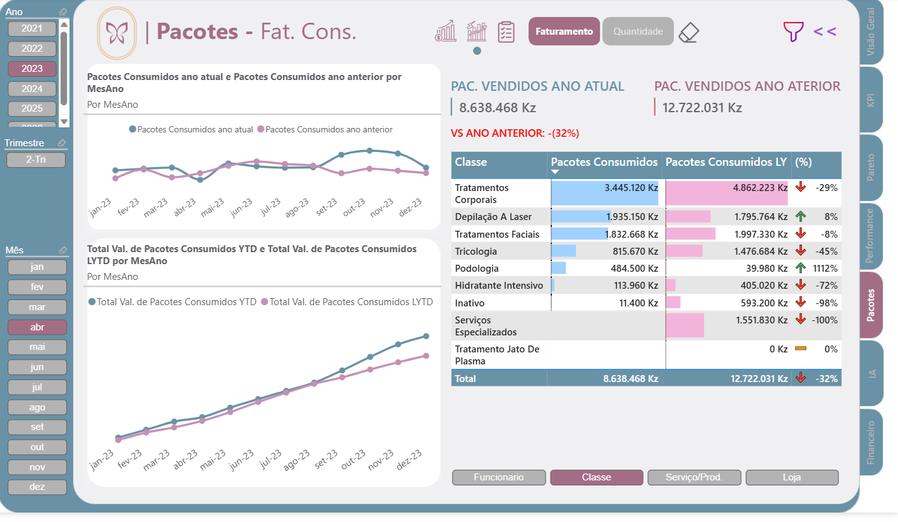 **Pacotes consumidos (YTD x LYTD)** |
| 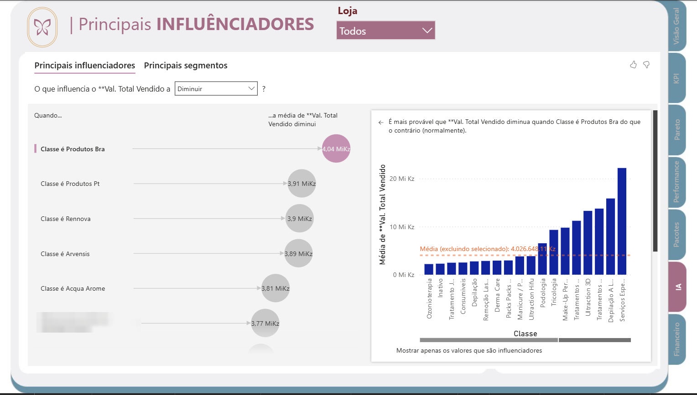 **Principais influenciadores (IA)** | 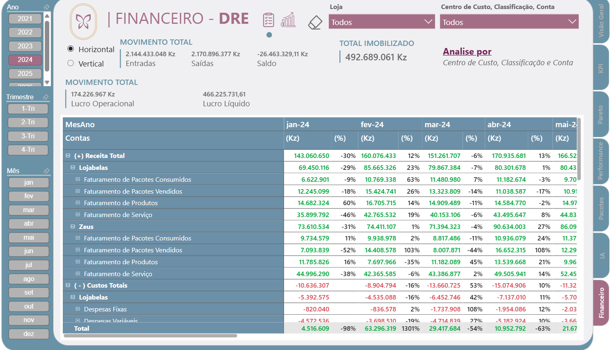 **DRE por unidade com AH/AV** |
| 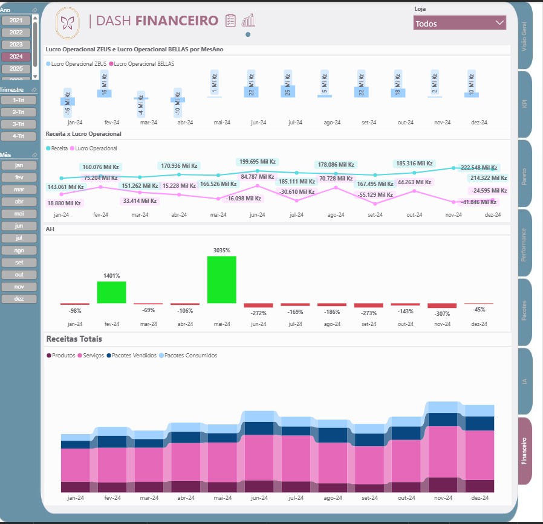 **Dashboard financeiro** | |
