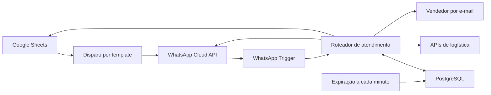

# Atendimento automatizado no WhatsApp com n8n

Projeto de referência para iniciar atendimento a contatos autorizados do Google Sheets pela WhatsApp Cloud API, apresentar um menu e manter o contexto por telefone em PostgreSQL.

**Status:** base para configuração e homologação. Os JSONs estão desativados e não foram validados dentro de uma instância n8n. As integrações de logística, credenciais e a camada de concorrência e recuperação precisam ser concluídas antes de produção. Não representa um caso já implantado em cliente.

## Comece aqui

1. Siga [Como importar e configurar no n8n](IMPORTAR-NO-N8N.md).
2. Consulte o [guia técnico completo](GUIA.html), baixando o HTML e abrindo no navegador.
3. Execute [schema.sql](schema.sql) no banco de aplicação.

## Recursos

- Disparo por template aprovado, personalizado com nome, com cadência de 3 a 5 segundos.
- Menu interativo: rastreamento, pagamento, frete e vendedor; fallback textual para rejeição de formato.
- Contexto persistente, expiração por inatividade de 30 minutos e tratamento de intenções por regras.
- Pausa do bot após transferência e supressão persistente de contatos que pedem para sair.
- Registro de aceite e falhas de envio, inclusive recibos assíncronos da Meta.
- Condições de pagamento editáveis e contratos para APIs de rastreamento e frete.

## Arquitetura



## Arquivos

| Arquivo | Finalidade |
|---|---|
| [01-disparo.referencia.json](01-disparo.referencia.json) | Workflow de disparo inicial |
| [02-atendimento.referencia.json](02-atendimento.referencia.json) | Workflow de entrada, menu e respostas |
| [03-expiracao.json](03-expiracao.json) | Workflow de expiração de contexto |
| [schema.sql](schema.sql) | Tabelas de sessão, eventos, campanhas, entregas, locks e outbox |
| [router.cjs](router.cjs) | Regras puras da conversa |
| [build.cjs](build.cjs) | Gerador dos workflows |
| [test.cjs](test.cjs) | Verificações locais do roteador |
| [GUIA.html](GUIA.html) | Arquitetura detalhada, parâmetros, template e checklist |

## Verificação local

Com Node.js instalado, dentro desta pasta:

```sh
node test.cjs
node build.cjs
```

São 19 verificações das regras de conversa, além de verificações de JSON, conexões e sintaxe dos nós Code. O gerador sobrescreve os três JSONs: ajuste as fontes antes de regenerar. Esses testes não substituem importação e execução ponta a ponta no n8n.

## Limites para produção

A seção 9 do guia detalha fila durável, lock por telefone, transação de estado com outbox, workers, reconciliação e cadência global. As tabelas SQL estão incluídas, mas os workers dessa camada ainda não estão implementados nos JSONs. O intervalo de envio não garante ausência de bloqueios pela Meta.

O projeto contém exemplos e placeholders, sem contatos reais ou tokens. Mantenha credenciais no n8n e não publique exports configurados sem revisar headers, dados fixados e nomes de credenciais.
