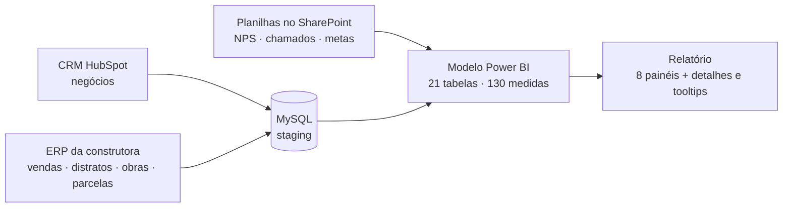
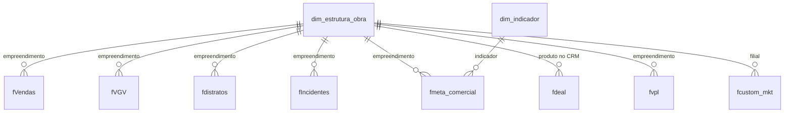

# 08 · BI Comercial de Construtora: NPS, Atendimento, Vendas e Funil de Marketing

> Relatório da diretoria comercial de uma **construtora e incorporadora**. Junta numa só navegação a satisfação dos clientes (NPS), o atendimento pós-venda, o comportamento de vendas e distratos, o funil de marketing vindo do CRM (HubSpot) e o retorno do investimento em mídia (CAC, CPL e ROI).

<!-- Tire o comentário depois de colocar o print na pasta imagens/:  -->

## Problema de negócio

Cada área olhava um pedaço da jornada do cliente em uma ferramenta diferente: o marketing no CRM, o comercial nas vendas do ERP, o pós-venda nos chamados de atendimento e a pesquisa de satisfação numa planilha. A diretoria queria acompanhar a jornada inteira, do lead à entrega, com metas por empreendimento e indicadores de eficiência do investimento em marketing.

## Solução

| Área | O que mostra |
|---|---|
| **NPS** | Promotores, neutros e detratores, NPS por empreendimento, zona de classificação e meta |
| **Manifestações negativas** | Detalhe dos detratores para ação do pós-venda |
| **Resolução de atendimentos** | Chamados abertos e encerrados, % de resolução, dentro e fora do prazo, abertos vencidos, meta |
| **Comportamento de vendas** | Vendas, distratos, vendas líquidas, % da meta, clientes novos x recorrentes, frequência de recompra (de "menos de 1 ano" a "7 anos ou mais"), visão mensal e acumulada |
| **Funil de vendas** | Visitantes → leads (MQL/SQL) → vendas, canais online x offline, conversão contra meta |
| **Despesas de marketing** | Investimento, CAC, CPL e ROI, realizado x meta, mensal e acumulado |
| **Carteira** | Valor presente (VPL) das parcelas a receber |

## Arquitetura

## Números do modelo

| Item | Quantidade |
|---|---|
| Tabelas | 21 |
| Medidas DAX | **130** |
| Consultas Power Query | 17 (MySQL, CSV e Excel no SharePoint) |
| Páginas | 26 (8 painéis, páginas de detalhe e *tooltips*) |

## Modelo de dados (núcleo)

A dimensão de empreendimentos (`dim_estrutura_obra`) é a ponte entre os sistemas: guarda o código da obra no ERP, o ID do produto no HubSpot e o código da filial no marketing.

## Destaques técnicos

- **NPS com zona de classificação** e tratamento de vazios. Ver [`dax/nps-atendimento.dax`](dax/nps-atendimento.dax).
- **Clientes novos x recorrentes** com `EXCEPT` entre os clientes do período e os de todos os períodos anteriores. Ver [`dax/vendas-clientes.dax`](dax/vendas-clientes.dax).
- **Frequência de recompra** em faixas de anos, a partir da diferença entre a primeira e a última compra.
- **Eficiência de marketing:** CAC, CPL e ROI, mensais e acumulados. Ver [`dax/marketing-funil.dax`](dax/marketing-funil.dax).
- **Integração do CRM** por uma camada de *staging* em MySQL. Ver [`power-query/hubspot-staging-mysql.m`](power-query/hubspot-staging-mysql.m).
- **Ponto de melhoria identificado:** o arquivo tem *Auto Date/Time* ligado (115 tabelas de data ocultas) e relacionamentos muitos-para-muitos com a dimensão de obras. O mesmo diagnóstico e o plano de correção do [projeto 06](../06-auditoria-performance-powerbi/) se aplicam aqui.

## Imagens

Prints em [`imagens/`](imagens/). Use dados fictícios ou anonimizados: o relatório original tem nomes de clientes.
